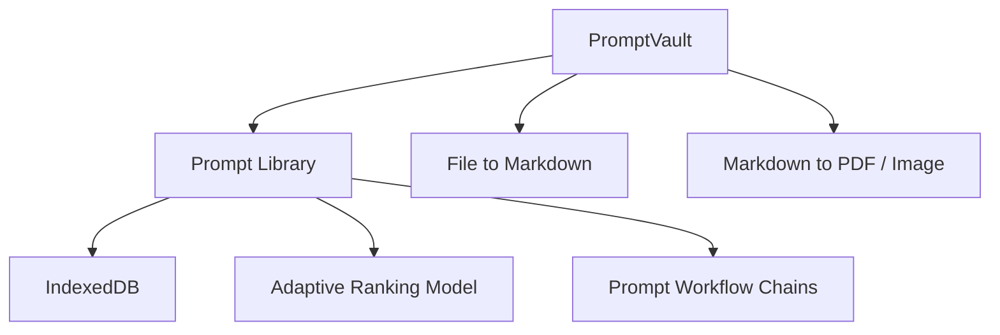

# PromptVault

**A browser-based workspace for managing AI prompts, building reusable workflows, and preparing Markdown documents.**

PromptVault brings three practical tools into one interface:

1. **Prompt Library** — organize, search, reuse, and maintain a personal prompt collection.
2. **File to Markdown** — convert supported text and source files into structured Markdown.
3. **Markdown to PDF / Image** — format Markdown content and export it as a PDF or image.

## Features

### 1. Prompt Library

- Create, edit, duplicate, organize, and search prompts.
- Use categories, tags, favorites, and collections.
- Define prompt variables and fill them before copying the final prompt.
- Track prompt usage and keep previous prompt versions.
- Build multi-step prompt workflows and run them step by step.
- Export and import a JSON backup of the library data.
- Export a prompt as an image.

### 2. Adaptive prompt ranking

The prompt library includes a small, in-browser neural ranking model that adjusts prompt ordering from interaction feedback.

- Uses 16 ranking features, including usage, recency, favorites, category and tag affinity, query relevance, novelty, and repeated-exposure signals.
- Uses a compact feed-forward network with 24 and 12 hidden units.
- Collects feedback signals such as copying a prompt, filling its variables, opening it, favoriting it, using it in a workflow, or asking to see it less.
- Updates the ranking model from collected interaction episodes and uses a limited exploration component so less-seen prompts can still be surfaced.

This is a **local adaptive ranking component**, not a general-purpose language model or a hosted AI service. The application source labels this component as reinforcement learning; the implementation is more precisely described as feedback-driven neural ranking / online preference adaptation.

### 3. File to Markdown

- Import multiple supported text-based files.
- Convert common formats such as plain text, Markdown, HTML, JSON, CSV, and source-code files.
- Configure conversion and formatting options.
- Preview the combined Markdown output before copying or saving it.

### 4. Markdown to PDF / Image

- Edit Markdown and preview the rendered document.
- Configure page size, margins, font size, and text direction.
- Export to PDF and image formats.
- Print the formatted document.

## Architecture

The project is packaged as a single-page application. The three tools are embedded in the main `index.html` file and opened from a shared interface.



## Technology

- HTML5
- CSS
- Vanilla JavaScript
- IndexedDB for browser-side prompt and workflow data
- Canvas-based image export
- In-browser PDF and document rendering components

No application server or build step is required for the current single-file version.

## Run locally

1. Download or clone this repository.
2. Open `index.html` in a modern browser.
3. Start using the tools from the PromptVault interface.

For a hosted demo, the repository can also be published with GitHub Pages.

## Data storage and privacy

- Prompt-library data is stored in the browser's IndexedDB database.
- Data is local to the browser profile and is not automatically synchronized between devices.
- Use the built-in JSON backup/export feature before clearing browser data or moving to another device.
- If IndexedDB is unavailable, the prompt library can fall back to an in-memory mode; data in that fallback mode will not persist after the page is closed or refreshed.
- The file-conversion tools process their input in the browser.

## Project status

PromptVault is a personal project currently used by its developer. The repository documents the current integrated HTML version. Browser compatibility, accessibility, performance, and security still need broader testing before treating it as a production-ready application.

## Repository structure

```text
promptvault/
├── index.html
├── README.md
└── .gitignore
```

## Future work

- Add automated tests for prompt storage, import/export, ranking, and conversion.
- Add repeatable evaluation datasets for the adaptive ranking model.
- Improve keyboard accessibility and cross-browser testing.
- Add an optional secure synchronization service if multi-device use is needed.
